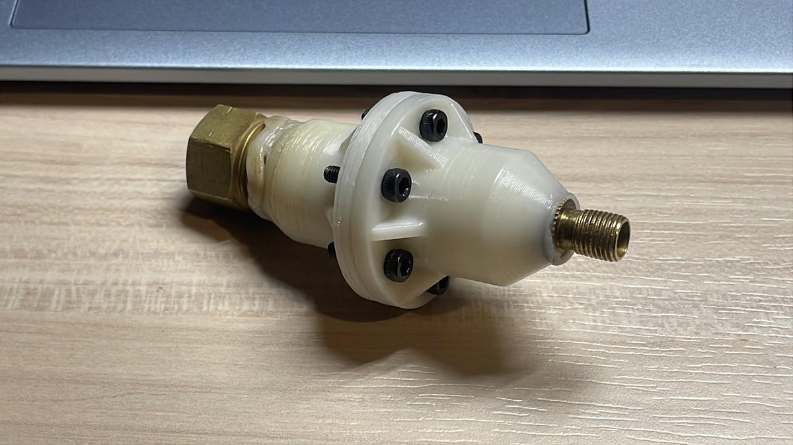
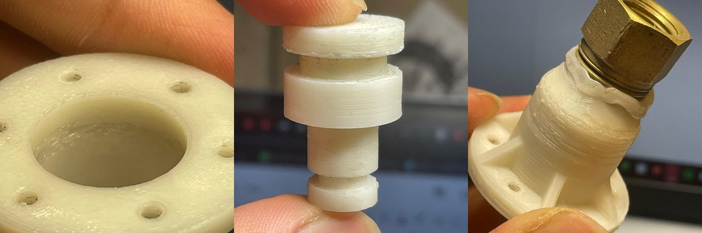

# ABS/GOX hybrid rocket engine

**Personal project with my twin brother · 2026 – present · Design stage, with component tests**

## Summary

A personal project to find out whether a fully 3D-printed ABS engine could work as a hybrid rocket engine with gaseous oxygen (GOX). ABS is both the structure and the fuel. The design is sized for a short, 25 N, 5 s burn. The project covers the engine only, not a full vehicle.

**Status:** the engine design is still in progress. No test firing and no ignition system are planned. So far the work is sizing calculations, research notes, and tests of printed components.

**My role:** a joint project with my twin brother. We work on the design together, and we printed and tested the small parts.

## What exists so far

- **A sizing spreadsheet** for a 25 N engine: throat, expansion ratio, mass flows and a first fuel-port estimate (see the table below).
- **A printed pressure-intensifier rig**, built to leak-test printed ABS hydraulically (10 bar pneumatic supply, 25 bar hydraulic side). Its first test failed, and most of the project's lessons so far come from that failure (see below).
- **A first thermal estimate for the nozzle**, which says a graphite nozzle itself should survive the burn, with some corrosion, but the housing around it would not (see below).

## Design point

From my sizing spreadsheet. These are design-stage values, not measurements.

| Parameter | Value |
|---|---|
| Nominal thrust | 25 N |
| Chamber pressure | 6 bar |
| Oxidiser-to-fuel ratio | 1.6 |
| GOX delivery pressure | 10 bar |
| Mass flow | about 15 g/s in total: 9.2 g/s GOX and 5.8 g/s ABS |
| ABS burnt in a 5 s run | about 29 g |
| Throat diameter / expansion ratio | 6.8 mm / 1.64 |
| Fuel port | helical, with swirled GOX injection; length not yet settled |
| Target oxidiser mass flux in the port | 125 kg/m²s (the sheet's reference range is 100 – 350) |
| c* | 1440 m/s: an empirical 1600 m/s with a 90% efficiency allowance for the swirl and helical port |
| Specific impulse | 170 s, which is an assumption and not a calculated value |

The mass flow follows from the thrust and the assumed specific impulse, F/(Isp·g), and the throat area from ṁ·c*/p_c.

## Printing accurate parts: trial and error

Getting FDM-printed ABS accurate enough to seal took a lot of trial and error with print settings and with allowing for shrinkage and warping. There is no formal test log. The table below is my notes from after the first intensifier test.

| Problem seen | Improvement identified |
|---|---|
| Too little material around the small-side (25 bar) attachment; bolt holes too close to the body | Remove a chamfer and move the holes away from the body |
| Overheating on both the inside and the outside surfaces, which worsened layer adhesion | Lower print temperature; enable fan cooling on short layers |
| Insufficient solid infill and under-extrusion | Raise the flow ratio, shorten retraction, add extra length on restart |
| O-ring grooves 0.1 mm too small in diameter | Adjust the contour offset |
| Leaks between layers | Acetone treatment, left to dry and harden completely. Baking for too long makes layers bubble and split |
| PTFE tape sealing too thin (6 wraps) | About 10 wraps |
| Large friction losses | Silicone grease |
| O-rings damaged on sharp corners | Chamfer at the piston and body interface |
| Top layer flared out | Lower flow ratio for the top layer |

For future prints the notes also suggest larger piston areas: smoother, wider arcs for accuracy, more effective smoothing, and room for O-rings thicker than 2 mm.

## What went wrong

**The first pressure test failed.** Pressure peaked at about 8 bar before water sprayed past the PTFE tape and there were major leaks around the bolted seam. There was also bubbling at the corner between the flat bolted face and the main body. Afterwards the piston with its O-rings was tested underwater at 10 bar, and showed a few small bubbles around the body and heavy bubbling in the O-ring bore.

The notes give three reasons for the O-ring seal failures:

1. an overheated bore, giving a rough surface that left gaps;
2. undersized grooves, so too little compression;
3. piston heads slightly under diameter, so the piston tilted and the O-ring was squeezed under pressure.

**The retest also failed, and I do not know why.** The causes written down are: water is incompressible, so with the piston submerged it could not move past its midpoint; pump vibration may have disturbed the seal; axis tilt may have jammed the piston; or the method was simply flawed. A later diagnostic of the 25 bar side on its own reached 33 bar with a hand pump and 25 bar with an electric pump. Whether pump vibration mattered was not tested.

**No test log was kept**, so the settings behind each print, and the pressures reached, were not recorded in a form others could reproduce.

## Research notes so far

- **Graphite nozzle.** A 1D transient heat-conduction estimate (a semi-infinite solid with a constant surface temperature, with diffusivity falling from about 80 mm²/s at 300 K to about 8 mm²/s at 2700 K) says the graphite nozzle itself should survive the 5 s burn, with some corrosion, but the housing around it would not. The estimate is crude. It overestimates, because it treats the wall as a flat semi-infinite solid at a high, constant surface temperature, and it underestimates, because it covers only the throat and not the thinner wall of the rest of the nozzle. The open question is how to hold and protect the graphite nozzle in the ABS.
- **ABS limits.** Typical values are a glass transition of about 105 °C, a heat deflection temperature of 80 – 100 °C, and thermal breakdown above about 270 °C.
- **Nozzle geometry.** A cone is the simplest to make. Erosion in a hot, oxygen-rich flow enlarges the throat and shifts the O/F ratio, and the nozzle should be slightly under-expanded so that erosion does not cause flow separation. The notes suggest a 30 – 45° convergent and 15° divergent cone, with an expansion ratio of about 2 that still needs checking against the sheet's 1.64.
- **Feed line.** A first check on tubing size: 10 g/s of GOX at 10 bar, with a density of about 13.1 kg/m³, is about 0.76 L/s.

## Design decisions

- **Test the material before the engine.** Whether FDM-printed ABS can hold pressure without leaking is the first thing to establish, so the first work is hydraulic leak testing of printed parts.
- **Short burn.** The design is sized for a 5 s burn.
- **Fully printed in ABS.** The aim is to see what desktop 3D printing can do.

## Still to do

- Settle the helical port length. The first estimate in the sizing sheet is being re-checked.
- Find and record the source of the regression-rate constants used in the sheet.
- Resolve how the graphite nozzle is housed and protected in the ABS, since the housing would not survive the burn.
- Write simulations of chamber pressure and fuel regression, and a thermal analysis of the ABS wall.
- Re-run the intensifier test with a proper log: print settings, measured dimensions, pressure reached and where it failed.
- Work out how leak-test results change with print orientation, wall thickness and infill.

## Scope and safety

Gaseous oxygen with a polymer fuel is an oxygen-compatibility and fire hazard, and a printed pressure vessel can fail suddenly. This is a design study with component-level tests. No hot-fire test and no ignition system are planned, and this repository documents design intent and results. It is not a how-to guide.
