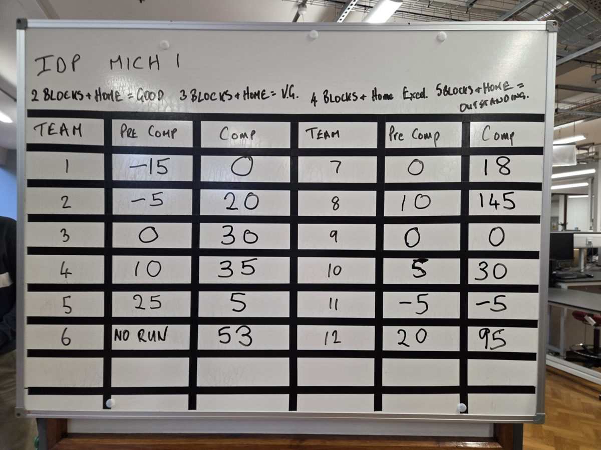
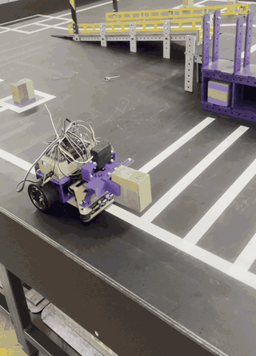

# Autonomous guided vehicle: Integrated Design Project

**Cambridge Engineering Part IB, team of 6 · Oct – Nov 2026 · Won the final competition (1st of 12 teams)**

## Summary

A four-week project to build an autonomous guided vehicle that collects blocks from pickup bays, reads each block's magnet pole, and delivers it to the right shelf bay, within a five-minute run. The hardware kit was fixed (PicoBot controller with a Raspberry Pi Pico RP2040, two geared DC motors, two servos, four line sensors, a Hall sensor, an IR receiver, a rear time-of-flight sensor, a start/stop button and three indicator LEDs), so the project was decided by the mechanism design, the software and the calibration.

**Result.** In the final competition our robot delivered six blocks in a clean five-minute run and scored 145 points. Second place scored 95. Our pre-competition run had scored 10.

**My role.** Project sub-lead. I wrote most of the AGV software (about 2,200 lines of MicroPython excluding tests), coordinated between the sub-teams before integration, and ran integration with a member of the electrical sub-team. I also helped the mechanical sub-team with the grabber design and weight reduction, laser-cut the prototype chassis, and soldered and debugged on the sensor board.

*Test run during development, before the IR receiver and button mount were fitted. There is no footage of the competition run itself.*

## How the software works

Full documentation is in `docs/`: [Code structure and algorithms](docs/Code_Structure_and_Algorithms.pdf) and the [software system diagram](docs/system_diagram.pdf), which maps every physical connection to the code.

- **Non-blocking main loop every 5 ms.** Stop button, beacon, delivery, junction, traffic light, then line following. Nothing in the loop waits: turns and grabs are timed inside it, so the stop button works all the way through, and the motors are cut on every exit, including an error.
- **Navigation by counting junctions, not measuring distance,** so the same code runs on all four competition tables. The table is a graph in `nav/map.py` with a shortest-path search; `nav/navigator.py` turns heading and position into left/right/straight at each junction.
- **Bay checking with one rear sensor.** The AGV turns into the bay front first, U-turns so the rear time-of-flight sensor faces the shelf, squares up and measures. A full bay is remembered and skipped for the rest of the run.
- **Sorting.** Where a block goes depends on the side it was collected from and its magnet pole, read three times before it is believed.
- **One config file.** Every pin number and tuned value is in `config.py`, so a wiring change never touches the logic.

### Who wrote what

The code is in the team repository, [IDP-repo (branch `rear_bay_detect`, `V3.5/sw`)](https://github.com/blakehrobinson-design/IDP-repo/tree/rear_bay_detect/V3.5/sw). I wrote most of it: the main loop, the navigation, mission and bay-check logic, and the drivers as they stand. The initial class backbone and the example code for reading sensors and driving servos and motors came from a teammate and the Pico examples, and a teammate wrote parts of the navigation and main loop (perhaps 10 to 20%) and most of the bench-test scripts in `tests/`. As the team's documentation declares: all algorithmic flows were devised by the group, and AI was used for repetitive changes, formatting, debugging and commenting.

## What I built by hand

- Assembled the robot (including grabber) when printed parts were ready for same day testing and full calibration
- Worked with the electrical sub-team on soldering and desoldering on the sensor board, and traced an output LED fault to a failed opto-isolator a few days before the final competition.
- Worked with the mechanical sub-team on the grabber design and on bringing the robot under the weight limit after the prototype came in overweight.

## What went wrong

- **Our first competition run failed.** Integration finished too close to the deadline, so there was almost no time to test the whole robot together. The final run worked because the three weeks after that were mostly testing and calibration: well over a hundred bench tests of individual parts.
- **Hard-coded timings.** Because the hardware was fixed and there was no odometry, the 90-degree turns, the U-turn and the bay-check manoeuvre rely on tuned timings in `config.py`. They had to be re-calibrated whenever the mechanism changed, and they would not transfer to another robot.
- **An unresolved edge case.** Testing found a boundary case that we never fixed; the competition run did not hit it. <!-- TODO(Jasper): say what the case was in one sentence. -->
- **Perfect versus good enough.** There was disagreement in the team about whether to aim for a pass or to try to win, and about how finished the mechanism had to be before moving on. We went with a "good enough" grabber, which made calibration harder, but it left time to test. Changing software is much cheaper than changing a mechanism, so a mechanism only has to be good enough for the software to work around.

## If I did this again

- Set the integration date a day earlier and treat it as fixed, because testing time was what separated the first run from the final.
- Put more thoughts into mechanical design choices, such as distance sensor placement at the front would greatly simplify bay check sequence
- Fix edge cases found in testing instead of hoping the run avoids them.
