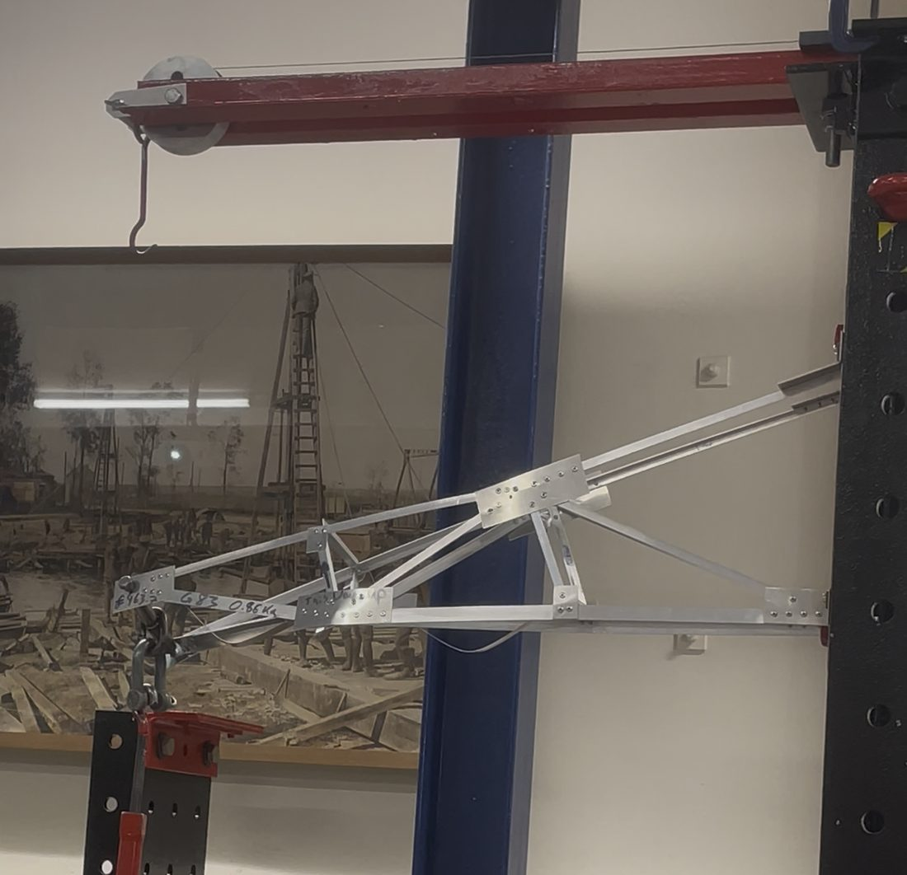
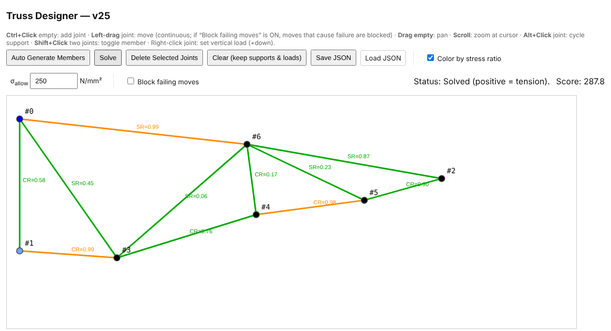

# Cantilever truss: design, optimisation and test to failure

**University pair project · 2025 · Complete, with post-mortem**

## Summary

An open-ended design problem, done in a pair: design and build a light aluminium cantilever truss, in two parallel planes, that carries 2.7 kN over an 800 mm span, then test it to failure. We used a browser-based truss solver and evolutionary optimiser to search for light designs for one plane, built the structure, and tested it to destruction to check the model against reality.

The optimiser designs a single plane for the full 2.7 kN. The real structure has two planes sharing the load, so each plane has a safety factor of 2 and the design failure load of the structure is 5.4 kN.

## Key numbers

| | Value |
|---|---|
| Span | 800 mm |
| Structure | Two parallel planes of aluminium angles with steel joint plates |
| Required load | 2.7 kN in total, shared by the two planes |
| Design load per plane in the optimiser | 2.7 kN, which gives a safety factor of 2 |
| Design failure load | 5.4 kN |
| Mass of the built structure | 0.86 kg |
| Modelled member mass of the saved candidates | 269 – 304 g per plane |
| **Measured failure load** | **550 N, about 20% of the required load** |

## The tool

`src/truss-designer.html` is a single-file HTML/JavaScript app with no dependencies. Open it in a browser, use **Load JSON** to open a design from `models/`, then **Solve** or **Optimize**.

- **Solver:** a 2D pin-jointed truss, which is one plane of the structure. Joints, members, supports and the tip load are edited on a canvas. Member forces come from joint equilibrium, solved as a linear system. Members are coloured by stress ratio (tension) or by buckling ratio (compression).
- **Sections:** five aluminium angle sizes, with cross-section areas from 27.7 to 73.2 mm². Tension is limited to σ_allow (250 N/mm² by default). Compression is limited by a buckling stress read from a slenderness curve (member length divided by section width).
- **Optimiser:** an evolutionary search over joint positions (Gaussian mutation) and member section sizes, with crossover and elitist selection. Four presets, from Fast to Max, set the population (24 to 64), number of parents, iterations (200 to 5000), mutation sizes and an early-stopping patience.
- **Objective:** total member mass, plus penalties for exceeding a stress or buckling limit, for members shorter than 100 mm, for joints closer than 50 mm and for crossing members.
- **Models:** `models/candidates-2700N/` holds the saved single-plane candidates for 2.7 kN. The number in each file name is the modelled member mass in grams, so `truss_model288.json` is a 287.8 g plane. `models/starting-layouts/` holds three simple starting layouts (`tri`, `bibi` and `tribi`).
- `src/truss-multi-viewer.html` shows several saved designs side by side.

### Who wrote what

I specified the objective and the evolutionary algorithm. Most of the code was written by an AI assistant from those specifications, not by me, so this repository shows engineering judgement about what to optimise and how to search, not programming of the JavaScript itself.

## What went wrong

The truss **failed by buckling at 550 N**, about 20% of the required load, because it was under-braced. The tool and its saved designs show why the model could not see this:

- **No margin.** The optimiser minimises mass against its own limits, so it pushes members to the edge. Every saved candidate has two to five members at 95% or more of their calculated stress or buckling limit. Any effect the model leaves out is then enough to cause failure.
- **One plane only.** The model is a single plane in its own plane. Bracing between the two planes, out-of-plane buckling and joint eccentricity were not modelled, so a design can pass every check in the tool and still be under-braced.
- **Mass was incomplete.** The objective counts member mass only, with no joint plates, fasteners or bracing. The saved candidates model 269 – 304 g of members per plane, so about 540 – 610 g for two planes. The built structure weighed 0.86 kg, so if it followed one of these candidates, about a third of its mass was never in the objective.
- **Stiffness was never calculated.** The tool has no deflection calculation, so it could not trade strength and weight against stiffness.

## If I did this again

- Model both planes and the bracing between them, and put joint plates and fasteners in the objective.
- Add out-of-plane buckling checks as constraints, and keep a utilisation limit (for example 0.8) so the search keeps a margin.
- Add a deflection calculation and search for a Pareto front of mass against stiffness and strength.
- Check the best few candidates with a finite-element model before building anything.
- Instrument the test with video and a load cell, and record which member buckles first, so that it can be compared with the model's prediction.

## What is not published

The structures project was assessed coursework. I publish only the design tool, the saved designs and this write-up, and not the engineering drawings or lab reports.
