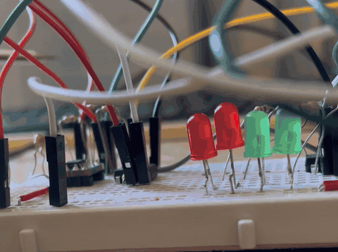
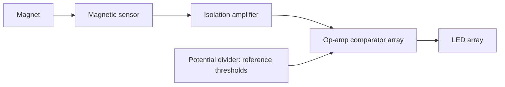

# Magnetometer (Electrical Project)

**University individual project · first year · Complete**

## Summary

An analogue circuit that lights more LEDs as a magnet moves closer to a sensor, so the number of lit LEDs indicates the field strength.

**My role:** individual project, from design through to a working circuit.

*Bench test, 7 s clip: the LED row responds as a magnet is moved toward the sensor.*

## How it works

1. The magnetic sensor outputs a voltage that changes with field strength.
2. An isolation amplifier passes that signal on while electrically isolating it from the rest of the circuit.
3. An array of op-amp comparators compares the signal against a ladder of threshold voltages.
4. A separate potential divider generates the thresholds, so each comparator switches at a different field strength.
5. As the magnet gets closer, more thresholds are crossed and more LEDs light.

## Skills used

Op-amp circuits, comparators, potential dividers and isolation amplifiers. The project followed a set of guided tasks, which I worked through in LTspice: op-amp characteristics and uses, different diodes, phase behaviour in inductor/capacitor/resistor circuits, and MOSFET characteristics.

## What I would do differently

I did the calculations as I went along and never drew a schematic, so there is no circuit diagram to publish. Next time I would capture the schematic in LTspice or KiCad at the start, so that the design can be reviewed and reproduced.
