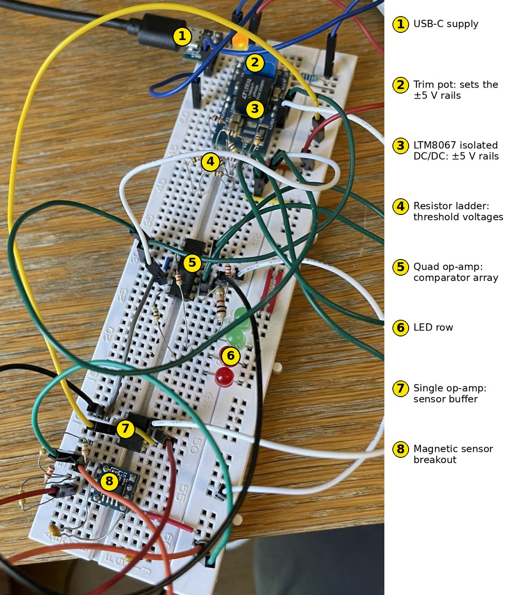
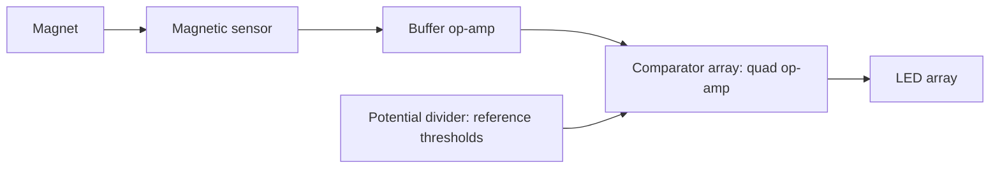

# Magnetometer (Electrical Project)

**University individual project · first year · Complete**

## Summary

An analogue circuit that lights more LEDs as a magnet moves closer to a sensor, so the number of lit LEDs indicates the field strength.

**My role:** individual project, from design through to a working circuit.

*Bench test, 7 s clip: the LED row responds as a magnet is moved toward the sensor.*

*The circuit on the breadboard. Signal path: sensor (8) → buffer op-amp (7) → comparator array (5), with thresholds from the resistor ladder (4), driving the LED row (6). The LTM8067 module (3) makes isolated ±5 V rails from the USB supply (1), trimmed with the pot (2).*

## How it works

1. The magnetic sensor outputs a voltage that changes with field strength.
2. A single op-amp buffers the sensor output so the comparator inputs do not load it.
3. A quad op-amp, used as four comparators, compares the signal against a ladder of threshold voltages.
4. A separate potential divider generates the thresholds, so each comparator switches at a different field strength.
5. As the magnet gets closer, more thresholds are crossed and more LEDs light.
6. The analogue stages run from ±5 V rails made by an LTM8067 isolated DC/DC module, trimmed with a potentiometer.

## Skills used

Op-amp circuits (buffers and comparators), potential dividers and an isolated DC/DC supply. The project followed a set of guided tasks, which I worked through in LTspice: op-amp characteristics and uses, different diodes, phase behaviour in inductor/capacitor/resistor circuits, and MOSFET characteristics.

## What I would do differently

I did the calculations as I went along and never drew a schematic, so there is no circuit diagram to publish. Next time I would capture the schematic in LTspice or KiCad at the start, so that the design can be reviewed and reproduced.
