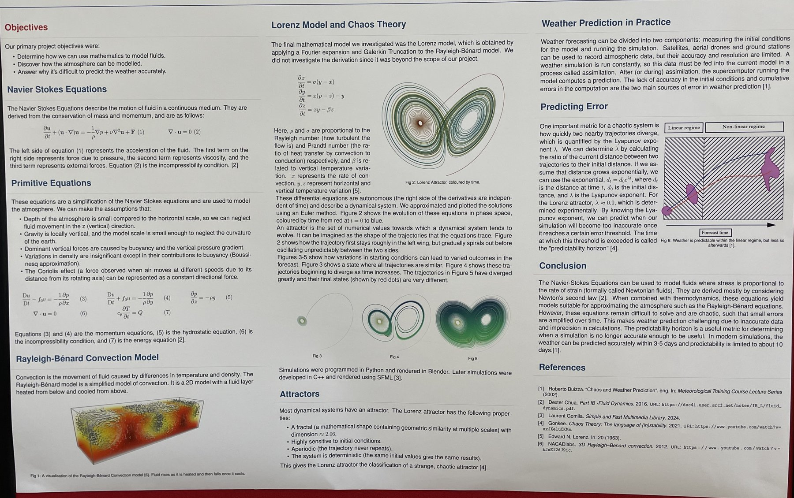

# School projects (Cambridge Maths School)

## Mathematics and Weather: group research poster (2024)

A group project, with three other students, on how the atmosphere is modelled and why the weather is hard to predict.

**My part:** mainly the mathematics and theory. I researched the equations, worked out what they mean, and presented and explained them to the rest of the group.

**Presentation:** the project ended with an event on 8 May 2024, attended by guests, students and parents from the school. After the PowerPoint presentation, I was asked to explain the poster, and I did so in discussion with visitors, both with the group and individually.

The poster covers:

- **Governing equations:** the Navier–Stokes equations, and the simplified primitive equations used to model the atmosphere.
- **Convection and chaos:** the Rayleigh–Bénard convection model, and the Lorenz system that comes from it. We did not derive the Lorenz equations, since the derivation was beyond the scope of the project.
- **Simulation (done by the group):** Lorenz trajectories solved with an Euler method and plotted in phase space, programmed in Python and rendered in Blender, with later versions in C++ using SFML.
- **Predictability:** sensitivity to initial conditions, the Lyapunov exponent (about 0.9 for the Lorenz attractor) and the predictability horizon.

## AstroPi: estimating the speed of the ISS (2023)

Python code for a Raspberry Pi experiment that ran on the International Space Station. The code modelled the station's orbital motion, projected 3D trajectories onto the Earth's surface, and used image-based point tracking to estimate the ISS's speed.

**What went wrong:** the results were poor. The station flew over the sea during our run, so the images had no fixed features to track and we could not determine the speed from them.

**What I would do differently:** design for the failure case. For example, detect when the images are featureless and fall back on the orbital model, rather than relying on the image tracking alone.
